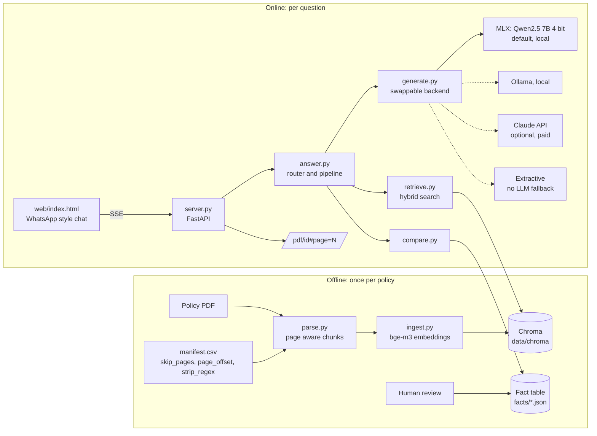
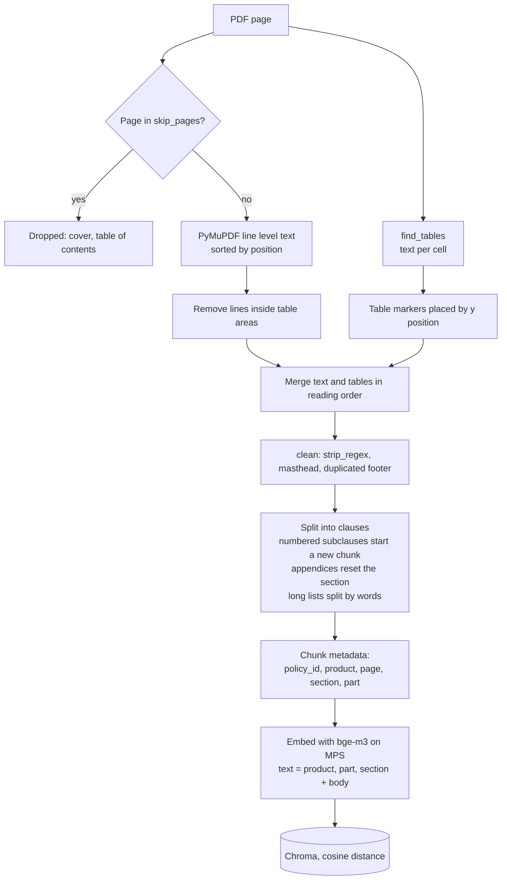
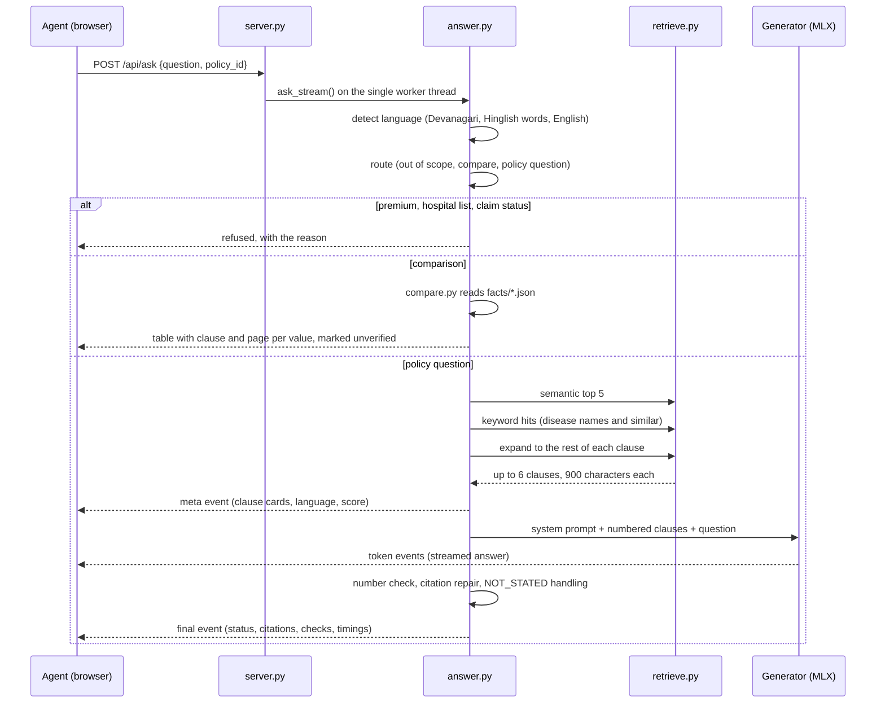
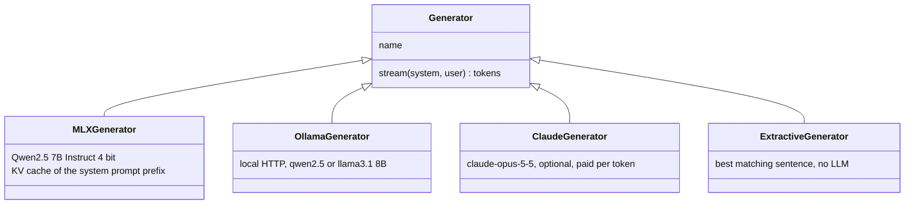

# System architecture: QuickPolicy by Claviq (local prototype)

An insurance agent asks about a health policy in English, Hindi or Hinglish. The copilot answers only from the policy wording, cites the clause and page, and says "not stated in the document" when the policy does not answer. The whole system runs on one MacBook Pro (M1 Pro, 16 GB) with no paid services and no network at run time.

## 1. High level view

Documents are prepared offline and searched online. Nothing in the online ask path re-parses PDFs. That is why answer time is a few seconds. The public demo line is "scans the policies" (answer latency), not a claim that each question re-reads the file from scratch.

## 2. Components

| Layer | File | Responsibility |
|---|---|---|
| Configuration | config.py | Paths, model names, chunk sizes, retrieval limits, backend choice, offline Hugging Face settings |
| Parsing | parse.py | PDF to clause level chunks with physical page numbers, tables extracted cell by cell, boilerplate and footer artefacts removed |
| Indexing | ingest.py | Embeds each chunk with bge-m3 and stores text, embedding and metadata in Chroma |
| Retrieval | retrieve.py | Semantic search, keyword search and section expansion, filtered by policy |
| Orchestration | answer.py | Language detection, routing, prompt building, grounding checks, citations, streaming events |
| Generation | generate.py | One `Generator` interface with four backends: mlx, ollama, claude, extractive |
| Comparison | compare.py, facts/ | Answers comparison questions from a structured fact table, not from free text |
| API | server.py | FastAPI app, streaming answers, model warm up, PDF serving |
| Front end | web/index.html | Chat UI, citation chips, clause cards, page links, "How this was checked" panel |
| Evaluation | eval_retrieval.py, eval_answers.py, demo_check.py | Retrieval recall, end to end answer checks, demo script regression |

## 3. Offline pipeline: parse and index

Each chunk keeps its top level "part" (for example "4 Exclusions"). Without it the model read the maternity exclusion as cover, so the part goes into both the embedding text and the prompt.

Gold labels and citations use physical PDF page numbers. The printed page number equals the physical page minus `page_offset`.

## 4. Online pipeline: answering a question

The server sends three kinds of server sent event. `meta` carries the retrieved clauses so the cards appear before the answer. `token` carries the streamed text. `final` carries the status (`answered`, `not_stated`, `refused`, `compared` or `blocked`), the citations, the result of the number check and the timings.

## 5. Grounding and safety controls

These controls matter more than model quality. Each one exists because testing showed a specific failure.

| Control | Where | What it prevents |
|---|---|---|
| Rule based router | answer.py `route()` | Guessing premiums, hospital networks or claim status, which the wording does not contain |
| Clause only prompt with [n] citations | answer.py `SYSTEM_PROMPT` | Answers from the model's general knowledge |
| NOT_STATED sentinel | answer.py | Inferring an absence, such as "there is no co-pay" |
| Part labels on every clause | parse.py, build_prompt | Reading an exclusion or a definition as cover |
| Banned absolute words unless written | SYSTEM_PROMPT | "Lifetime", "guaranteed", "all hospitals", "no limit" |
| List notes | answer.py `list_notes()` | Missing that a named disease sits under a specific waiting period sub heading |
| Keyword retrieval | retrieve.py `keyword_hits()` | Semantic search ranking a long list clause low when it names the exact disease |
| Section expansion | retrieve.py `expand_sections()` | Losing the second half of a clause that continues on the next page (clause 4.3) |
| Number check | answer.py `check_numbers()` | Any figure (amount, percentage, period) that is not in a cited clause. The draft is blocked and replaced with a verbatim quote |
| Citation repair | answer.py | Answers whose citation numbers do not match the clauses shown |
| Fact table for comparison | compare.py | Comparing policies from free text search, which mixes clauses from different products |

The UI shows the outcome of these checks in the "How this was checked" panel. Verification by the agent is the product.

## 6. Generation backends

The backend is chosen with `COPILOT_BACKEND` (default `mlx`). All four share the same prompt, checks and output format, so they can be compared on the same eval set.

The MLX backend fills the KV cache with the system prompt once and trims back to that prefix after each answer. This cut first token latency from 5 to 9 seconds down to 3 to 4.5 seconds. MLX is not thread safe, so the server runs every generation on a single worker thread.

The 3B model is kept only as a fallback. In testing it said pre-existing diabetes is covered without a waiting period, so it must not be used in a demo.

## 7. API

| Method and path | Purpose |
|---|---|
| GET /api/status | Ready flag, active backend, load error if any |
| GET /api/policies | Policies from the manifest, for the selector |
| POST /api/ask | Streams `meta`, `token` and `final` events for one question |
| GET /api/compare | Comparison table from the fact table |
| GET /pdf/{policy_id} | Serves the source PDF; the UI links to `#page=N` |
| GET / | Static chat UI from web/ |

The server binds to 127.0.0.1:8000 only. On startup it loads the embedding model and the generator, runs one search and pre fills the prompt cache, so the first real question is fast.

## 8. Data stores

| Store | Location | Contents | In git |
|---|---|---|---|
| Policy PDFs and manifest | data/policies/ | Source documents and per policy parsing settings | Yes |
| Vector index | data/chroma/ | Chunks, bge-m3 embeddings, metadata | No, rebuilt by ingest.py |
| Fact table | facts/*.json | 12 attributes per policy with clause and page, `verified` flag | Yes |
| Models | models/ | bge-m3, Qwen2.5 7B and 3B (MLX), fetched with fetch_models.sh | No |
| Eval set | eval/questions.yaml, eval/gold/ | 20 questions in three languages, gold pages and answers | Yes |
| Reports and dumps | eval/reports/, data/dumps/ | Eval output and chunk dumps for human review | No |

## 9. Runtime footprint

| Item | Value on the M1 Pro, 16 GB |
|---|---|
| Memory | About 5 GB for the 7B model plus roughly 2 GB for bge-m3 (estimated from weight sizes, not profiled) |
| Cold start | 30 to 60 seconds to load the models |
| First question after start | About 15 seconds |
| Warm answer | About 5 seconds median, first words after 3 to 4.5 seconds |
| Retrieval | Recall at 3 of 100% on 17 answerable questions (English, Hinglish, Hindi) |
| Answers | 17 of 17 answerable questions answered, 3 of 3 not-stated questions refused, 0 drafts blocked |

## 10. Known limits

Only one policy is loaded: National Mediclaim 07/2014, used for pipeline testing. Its mental illness exclusion is probably out of date against current regulation. The fact table and gold labels are pre-filled and not yet verified by a person. The score ranges of answerable and trap questions overlap, so refusals depend on the router and the model rather than a similarity threshold. Questions are typed only, there is one user at a time, and there is no authentication.

## 11. Path from prototype to production

| Concern | Prototype | Production direction |
|---|---|---|
| Channel | WhatsApp style web chat | WhatsApp Business API or the agent app, behind the same /api/ask contract |
| Policies | One, parsed by hand tuned manifest settings | Ingestion queue per insurer, a parsing QA step, versioned wordings with effective dates |
| Facts | JSON files, unverified | Reviewed fact store with an audit trail, one row per attribute and version |
| Generation | Local 7B on a laptop | Hosted model behind the same Generator interface, chosen by the eval set |
| Vector store | Chroma on disk | Managed vector database with policy and version filters |
| Concurrency | Single worker thread | Stateless API instances and a separate inference service |
| Governance | Eval scripts run by hand | Eval in CI on every prompt or model change, logging of every answer with its citations |
