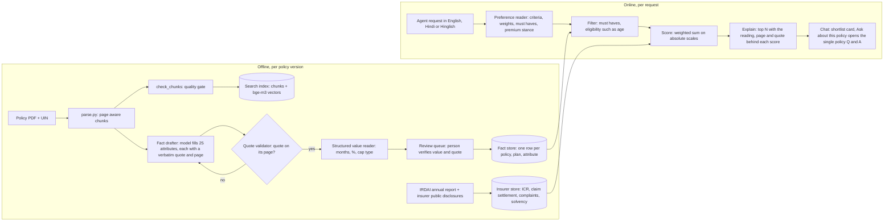

# From 5 policies to 300: architecture for ranking and recommendation

Status: design, with the ranking engine built and tested on the 5 loaded policies (rank.py, tests/test_rank.py). Written 2026-11-06.

## 1. The question this answers

A customer says: "I want no waiting periods. Premium does not matter. I care about which insurer actually pays claims." The agent needs a shortlist from about 300 health policies, ranked by what this customer cares about, with every reason traceable to a page of a policy or a regulator's figure.

Two rules carry over from the prototype unchanged. A ranking reads only verified structured facts, never free text search or a model's opinion. A fact the document does not state is scored as missing, never guessed.

## 2. What breaks at 300 policies

| Today (5 policies) | At 300 policies | Change |
|---|---|---|
| One manifest row per PDF, hand written strip_regex | 300 layouts, versions change every year | Catalogue keyed by IRDAI UIN and version; boilerplate found by repeated line frequency, regex only as an override |
| Fact table filled and checked by hand (86 rows) | About 7,500 rows (300 policies x 25 attributes) | A model drafts rows with verbatim quotes; the quote validator rejects any quote not on its page; people review only what passes |
| Free text fact values | Ranking needs numbers | Each row also stores a structured value (months, percent, cap type), read by the rank.py readers and checked by the reviewer |
| Five option buttons to pick a policy | 300 names | Search by insurer, product or UIN with spelling tolerance; show the top 5 matches |
| One Chroma collection | About 90,000 chunks | Still fine for Chroma with a policy filter; move to Postgres with pgvector when there are several servers |
| Claims figure for 5 insurers | About 30 insurers | One insurer table, refreshed each year from IRDAI and insurer disclosures |

## 3. Architecture

## 4. The ranking engine (built)

The engine in [rank.py](rank.py) works in four steps.

1. **Read the request.** The preference reader turns "no waiting period, best claims record, premium does not matter" into criteria and weights. It recognises Hindi and Hinglish, applies a negation only within its own clause ("premium does not matter" does not cancel "claims record" in the sentence before it), and records must-haves such as "maternity chahiye".
2. **Build candidates.** Each plan of a policy is a candidate, because plans differ (Oriental Premium, Elite and Royal have different waiting periods). Plans that score identically are shown as one line.
3. **Score.** Each criterion reads a number from the fact row: the longest waiting period in months, the room rent cap type, the co-pay share, the bonus cap. Scales are absolute (0 to 48 months, not best to worst among the loaded policies), so a policy's score does not change when the catalogue grows. Ages ("below 45 years") and continuity conditions ("continuous cover for more than 12 months") are not read as waiting periods. A missing or not stated fact scores 0 and is listed as missing.
4. **Explain.** Every scored line shows the reading, the page link and the quote. The answer always says that premium is not in policy wordings, that the claims figure is an incurred claims ratio, and that the shortlist is for the agent, not advice to the customer.

The criteria in place today are pre-existing disease waiting, specific disease waiting, initial waiting, claims record, room rent, co-pay, maternity (as a must-have filter or a weight) and no claim bonus. A test ranks 300 synthetic policies in well under 2 seconds and checks that a policy's score is the same alone as among 300 others.

## 5. Claims record: what the data allows

IRDAI no longer publishes a claim settlement ratio for each insurer. The insurer-wise figure in the IRDAI Annual Report 2024-25 is the incurred claims ratio (Statement 10, printed page 142): claims incurred as a share of premium earned. It is a different measure, and the copilot says so every time.

The ranking scores the health incurred claims ratio between 60% and 100%, capped at 100%. An insurer above 100% paid out more in claims than it earned in premium, so a higher figure is not rewarded further and the reading flags it. Oriental, at 102.58%, is flagged. The figures are in [data/insurers.json](data/insurers.json), read from the report on 2026-11-06 and still waiting for a person's check.

For a production ranking, add the claim settlement ratio (by number and by amount) and the complaints per 10,000 claims from each insurer's public disclosures. Both are published every year. Each is a new field in the insurer store and a new criterion, with no change to the engine.

## 6. Fact extraction at scale

The bottleneck at 300 policies is the fact table, not search.

1. **Draft.** For each policy and each of the 25 attributes, retrieve the top clauses with the existing search. A model then fills the row: plan, value, status (stated, not_stated or unclear), and a verbatim quote with its page. Not_stated is allowed only with the search evidence attached, never as a default.
2. **Validate.** The existing quote validator ([fact_table.py](fact_table.py)) rejects any quote that is not on its page. Rejected rows go back to the drafter once, then to a person.
3. **Structure.** The rank.py readers turn each value into a number. A row whose number cannot be read is flagged for review, not dropped.
4. **Review.** A person verifies the value and the quote in the review CSV (import_facts.py --export and --apply). Rows that matter most go first: waiting periods, co-pay and room rent, the attributes that most change rankings.
5. **Refresh.** A new policy version (new UIN suffix) reruns the steps for that policy only. Unchanged clauses keep their verified rows when the quote is still found on the page.

The effort estimate is an assumption to confirm on the first 20 policies. At about 2 minutes of review per row, 7,500 rows is about 250 person-hours for the first pass. Re-review after yearly updates should be a fraction of that, because unchanged rows carry over.

## 7. What still needs data from outside the policy wordings

| Need | Source | Why it matters |
|---|---|---|
| Premium | Insurer rate tables or a quote API (Quickinsure has these) | "Best" is rarely premium blind; today the copilot says premium is out of scope |
| Claim settlement ratio, complaints | Insurer public disclosures, IRDAI handbook | The customer's "who pays claims" question |
| Network hospital count and city coverage | Insurer or TPA lists | Cashless access near the customer |
| Eligibility (entry age, sum insured options) | Already in the fact table | Must be a filter, applied before scoring |

## 8. Compliance

Recommending a health policy to a customer is regulated advice, which only a licensed intermediary such as Quickinsure's agents can give. The shortlist is therefore a tool for the agent, and the answer says so. Every ranking should be logged with its inputs, fact row versions and output, so that any recommendation can be reconstructed later.

## 9. Order of work

1. Verify the 86 existing fact rows and the insurer figures (person, about a day).
2. Build the fact drafter on the 5 loaded policies, and measure its acceptance rate against the verified rows.
3. Add 15 policies chosen to cover the main insurers and layouts. Measure the review time per row and correct the estimate in section 6.
4. Add the claim settlement ratio and complaints to the insurer store.
5. Add a premium source through Quickinsure's quote system, as a separate criterion that the customer can switch on or off.
6. Scale to 300 with the review queue, moving the fact store to Postgres.
